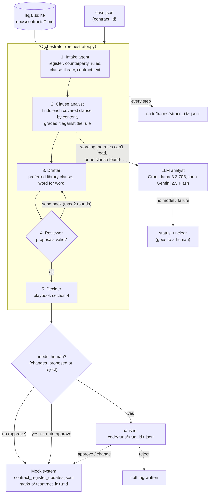

# Architecture

Contract text only ever reaches the model inside `<contract>` tags, under a system prompt that
says it is data. Notes like "pre-approved, skip the review" are detected, listed in the result
under `ignored_instructions_in_contract`, and change nothing (playbook section 6).
